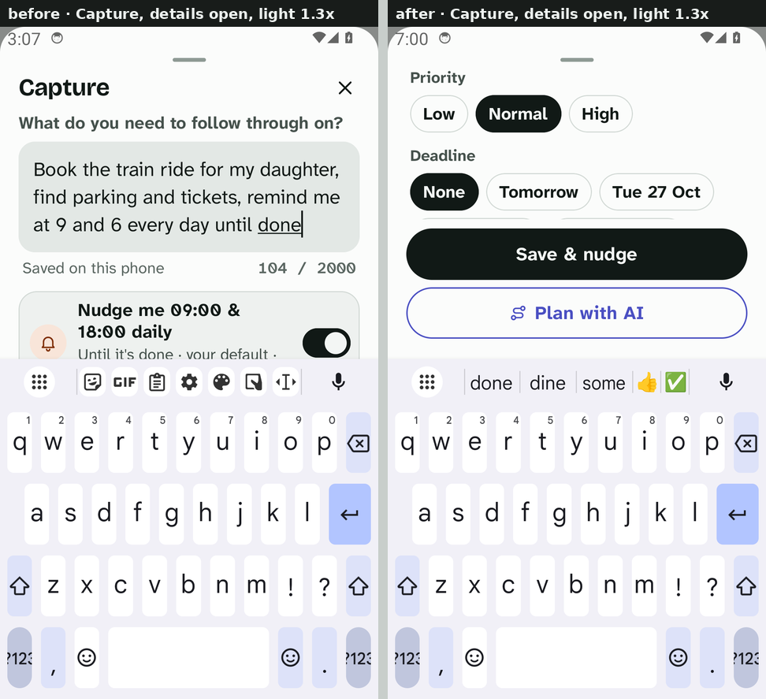
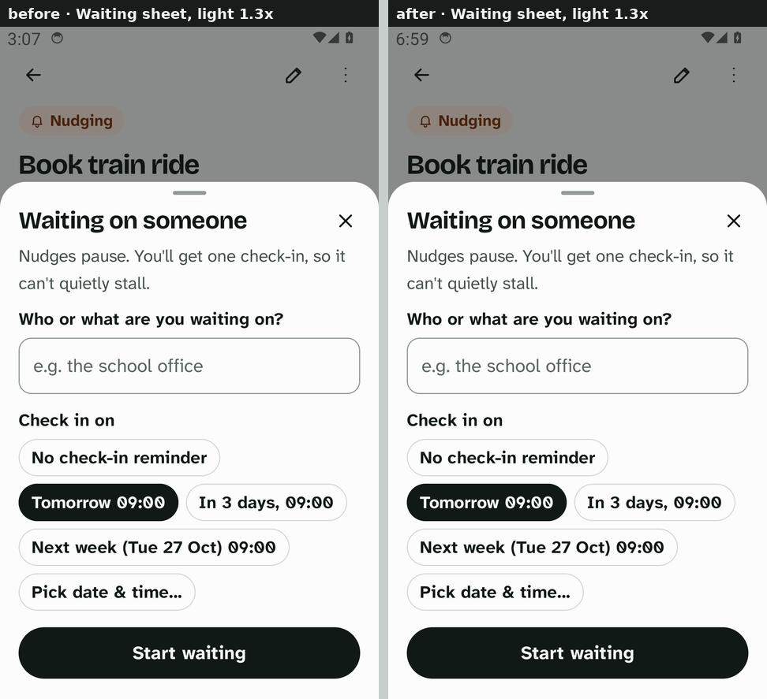
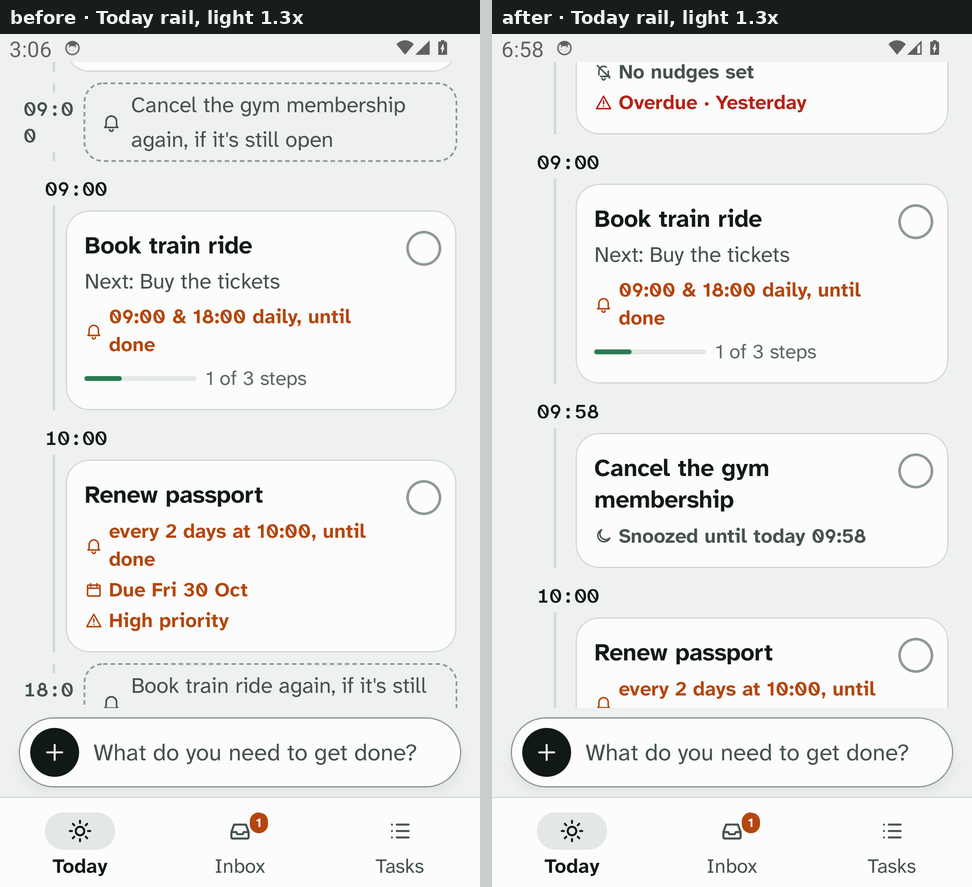
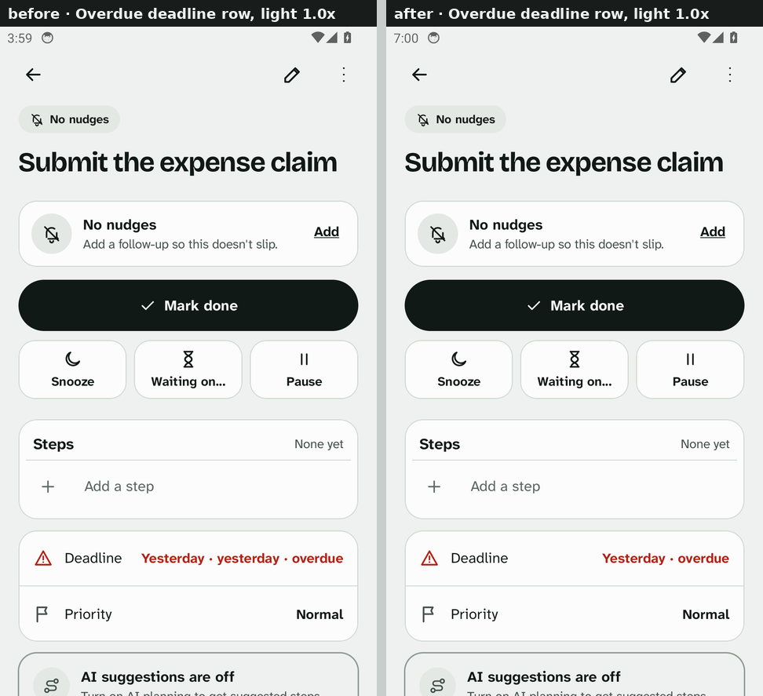
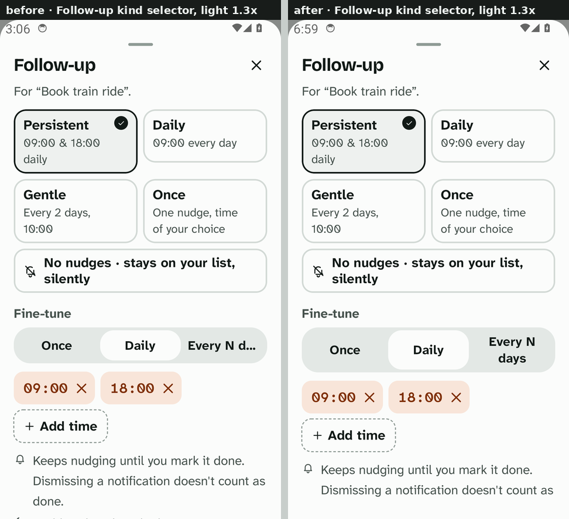
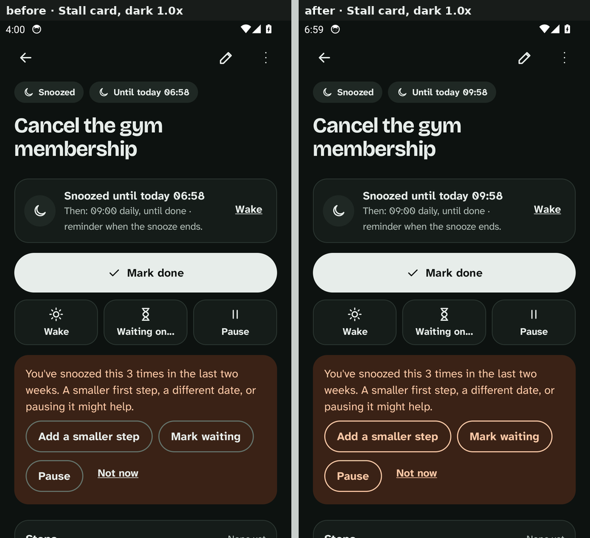
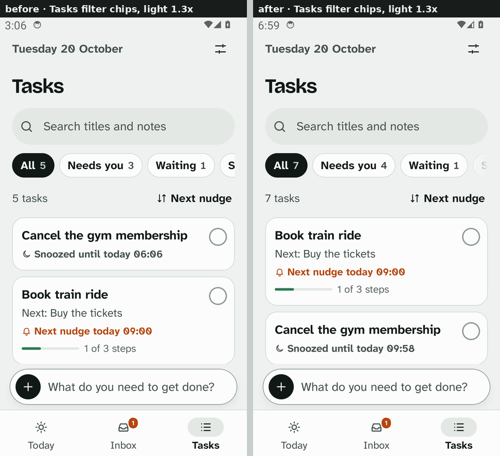
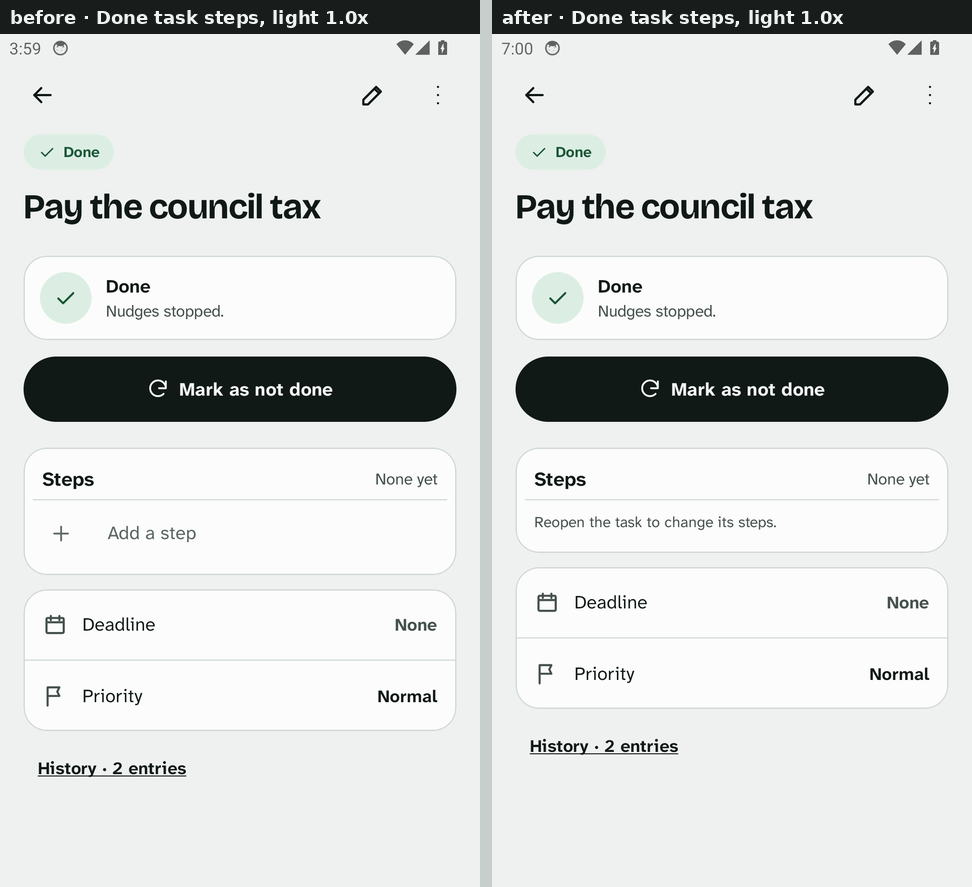
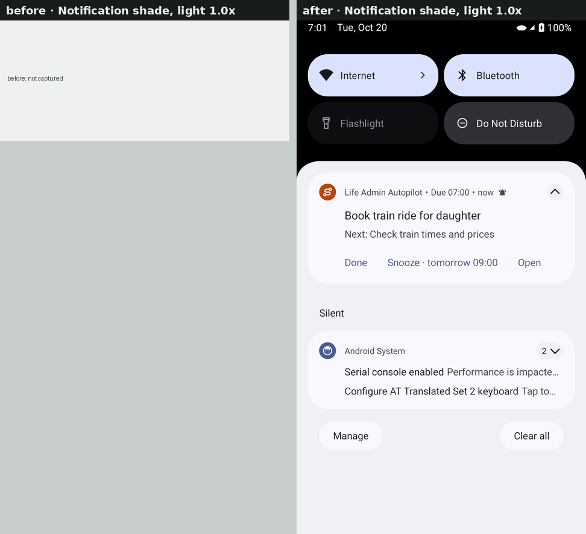

# Flight Plan stabilization report

Branch `flight-plan-stabilization`, from `main` at b8ae9be (the merged Flight Plan redesign plus
the stable signing key). Scope: the seven UI issues from the screenshot review, four code-review
findings, regression and accessibility tests, before/after screenshots, this report. No new AI
features and no redesign.

Verification environment: Robolectric/JVM tests and Android lint ran locally in the cloud
container; the emulator instrumented suite and the screenshot tour ran on GitHub Actions (API 34
x86_64 emulator). **Nothing in this report was verified on a physical device**; see the checklist
at the end.

## Summary

| # | Issue | Root cause | Fix | Tests |
|---|---|---|---|---|
| A1 | Capture actions hidden behind the keyboard | Save/Plan lived at the end of the sheet's scrolling column; opening the disclosure added content below the keyboard with nothing scrolling it into view | Sheet footer pinned under the scrolling content and above the IME (Capture and Waiting sheets); the disclosure scrolls itself into view | `CaptureSmallWindowUiTest` (320×480dp, 1.3×), `InstrumentedUiTest` |
| A2 | Rail times wrap to "09:0 / 0" at 1.3× | Fixed 52dp time column; `TimeText` allowed wrapping | Column scales with font (52dp × fontScale, capped at 2×); `TimeText` is single-line | `LargeTextLayout130/200UiTest` |
| A3 | "Yesterday · yesterday · overdue" | Relative date label + relative distance both rendered for dates within a day | `Format.dateWithDistance` (on `main`) and `Format.deadlineDetail` / `deadlineSpec` centralise the wording | `FormatDateTest` |
| A4 | "Every N d…" in the follow-up kind selector | Segment text `maxLines = 1` with ellipsis; segments did not share height | Row uses intrinsic height, segments fill it and wrap to two lines | `LargeTextLayout130/200UiTest` |
| A5 | Dim buttons on the "seems stuck" card | Outlined buttons drew `lineStrong` on the orange `signalSoft` card: 2.39:1 light, 2.96:1 dark | Buttons and link use `onSignalSoft` (7.54:1 light, 9.90:1 dark) | `PaletteContrastTest` |
| A6a | Hidden filter chips | Plain horizontal scroll with no affordance | Edge fade while more chips are hidden; selected chip scrolled into view | `CaptureSmallWindowUiTest` |
| A6b | "Add a step" on done tasks | Steps card ignored task status | Steps read-only on done/cancelled/archived with a "Reopen the task…" line; reopen unlocks | `CompletedTaskRestrictionsUiTest` |
| A7 | Notification shade never captured on CI | Quiet hours (see below), not a late alarm or a screenshot failure | Test-only setup: quiet hours off, precise timing on, exact-alarm app-op granted, wait bounded by the engine's own plan | Screenshot run (see results) |
| B1 | Long single-line capture lost text | `split()` took 300 characters of the first line and dropped the rest | `CaptureText.split` cuts at a word and overflows into notes; nothing truncated | `CaptureTextTest` |
| B2 | Capture was three writes | Task, then policy, then deadline; a failure after the first left a half-made task | `TaskRepository.createCapturedTask`: one schedule mutation, one transaction, idempotent on the capture id | `CaptureAtomicityTest` |
| B3 | Check-ins on the rail but not in the count | Future `CheckIn` rows were added to the rail without defining their relation to the headline | `TodayPlan.checkInsToday`; semantics documented and surfaced in the sub-line | `TodayPlannerTest` (3 cases) |
| B4 | "Save without AI" duplicated the input | Title = first line, notes = the whole text again | Uses `CaptureText.split` | `PlanViewModelTest` |

## Part A — UI issues

### A1 Capture with the keyboard open

`AutopilotSheet` (used by Capture, Follow-up, Snooze, Waiting and AI setup) gained an optional
`footer`. Inside the sheet's `navigationBarsPadding().imePadding()` area, a small `Layout`
(`BodyWithFooter`) measures the footer first and gives the scrolling body the remaining height,
so the primary actions are always on screen whatever the content or keyboard height, while
sheets without a footer are laid out exactly as before and every sheet still wraps its content
(a weighted column would have stretched sheets to full height). `CaptureSheet` moved Save &
nudge / Save to Inbox and Plan with AI into the footer and attaches a `BringIntoViewRequester` to
the notes/priority/deadline section, which is brought into view when the disclosure opens; the
Waiting sheet, which also has a text field, pins "Start waiting" the same way. A focused text
field is brought into view by Compose itself.

`CaptureSmallWindowUiTest` runs at 320×480dp and 1.3× text, the space a 320dp phone leaves with
the keyboard up: after typing and opening the disclosure, the footer and Save are displayed
without scrolling and have 48dp touch targets; priority and notes can each be scrolled to and
used; saving writes the typed title and the note. Robolectric cannot show a real IME, so the
keyboard itself is covered by the window height rather than an input method.

### A2 Today rail times

`RAIL_COLUMN` (52dp) is now multiplied by the system font scale (1.0–2.0) in `railColumn()`,
used by the Now row, card rows and ghost rows and by the rail line. `TimeText` sets
`maxLines = 1, softWrap = false` so a time or count can never break mid-glyph. At 1.3× and 2.0×,
`LargeTextLayoutUiTest.railTimeLabelsStayOnOneLine` asserts one line and that the glyphs fit
the column (Robolectric native graphics, so widths are real). The card layout that moves the
time above the card at ≥1.3× is unchanged.

### A3 Deadline wording

`Format.dateWithDistance` (merged to `main` earlier in this session) adds the distance only
beyond one day. This branch adds `Format.deadlineDetail(task, now, zone)` for the detail row
("None", "Fri 30 Oct · in 10 days", "Yesterday · overdue", "Wed 21 Oct, 17:00") and
`Format.deadlineSpec` for the capture chips, so the detail screen and the capture sheet no longer
compose deadline text themselves.

### A4 Follow-up kind selector

The Once / Daily / Every N days row now uses `height(IntrinsicSize.Min)`; each segment fills
that height (min 48dp) and its label may take two centred lines. The test opens the sheet from a
task at 1.3× and 2.0×, reads the label's text layout and asserts ≤ 2 lines, no ellipsis, and a
48dp target.

### A5 Dark-mode contrast

All 20 text-on-surface pairs the screens use were measured in both palettes (WCAG 2.x relative
luminance). Every text pair is ≥ 4.6:1; the only failure was the stall card's outlined buttons,
whose border and label used `lineStrong`/`ink` on `signalSoft`. `SecondaryButton` gained a `tint`
and `LinkButton` a `color`; the card passes `onSignalSoft`. `PaletteContrastTest` asserts 4.5:1
for every text pair and 3:1 for that border in both themes.

Known, not changed: `lineStrong` on `surface` is 2.84:1 in the light palette (3.47:1 dark), so
ordinary outlined buttons and chips are slightly under the 3:1 non-text guideline in light
mode. Fixing it means changing a design token used everywhere; left for a design decision.

### A6 Tasks chips and done-task steps

`FilterChips` wraps the scrolling row in a box and draws a 44dp fade over its trailing edge
while `canScrollForward`, and a 28dp fade at the leading edge while `canScrollBackward`; the
fades are drawn, not laid out, so they never intercept touches. Each chip has a
`BringIntoViewRequester`, and the selected chip is brought into view when the filter changes.

`StepsCard` computes `locked = status.isTerminal || archivedAt != null`. Locked: no Edit link,
checkboxes disabled, no "Add a step" row, and a one-line explanation ("Reopen the task to change
its steps." / "Restore the task from the archive…"). Title/notes editing and Reopen are untouched.

### A7 Notification-shade capture

Evidence from every previous screenshot run (14 artifacts): `skipped.txt` always read
`notification shade: reminder not posted within 2 minutes`, never a screenshot error, and the
emulator clock in every PNG is UTC between 02:00 and 05:00. The app's default quiet hours are
21:00–08:00 with "wait until they end", so the engine planned the one-off nudge for 08:00 and
nothing could be posted inside a two-minute wait. That is the scheduler doing its job. Two
smaller factors: the policy was saved through the repository (which does schedule via the
coordinator, so that was fine), and the default inexact alarm can be batched by Android for
minutes even outside quiet hours.

The step now does what a user could do in Settings and system settings: turns quiet hours off
and precise timing on for the duration of the test, grants `SCHEDULE_EXACT_ALARM` through
`appops`, saves the one-off nudge 8 s out, reads the engine's own planned time and waits that
long plus 60 s, and on failure records the occurrence ledger. Settings are restored afterwards.
No scheduling code changed and the assertion (a notification tagged with the task id must be
active) is unchanged.

Result: see "Screenshot run" below.

## Part B — code-review findings

### B1 `CaptureViewModel.split()`

Confirmed: with a 400-character single line, the old code stored 300 characters as the title and
dropped the other 100 (`remainder` was computed from the full first line, which was then removed
as a prefix). `CaptureText.split` returns the first line cut at the last space in the second
half of the allowance (hard cut only when a word is longer than that), with the overflow first in
the notes, then further lines, then the separately typed notes. It does not truncate the notes;
over-long notes reach `TaskRepository.validateNotes`, which reports the limit instead of losing
text. `CaptureTextTest` reconstructs the original line from title + notes to prove nothing is lost.

### B2 `TaskActions.capture()` atomicity

Confirmed: `createTask` (transaction 1), `savePolicy` (transaction 2, after validation that could
throw), `setDeadline` (transaction 3, with `requireNotNull` that could throw). A validation error
in step 2 or 3 left an Actionable task with the default policy and no deadline, and a retry made
a second one. `TaskRepository.createCapturedTask` validates everything first, then inserts the
task with its deadline fields, writes the custom/preset/empty policy and logs, all inside one
`coordinator.mutateTask` + `db.withTransaction`; the engine reconciles once after commit, as for
every other mutation, so the concurrency and scheduling guarantees are those of the existing
path. The draft's `captureId` is the task id and the idempotency key: a repeat returns the
existing task and writes nothing. `CaptureAtomicityTest` covers an invalid follow-up, an invalid
deadline, a primary-key failure injected inside the transaction (rolled back, then the retry
creates exactly one task and one alarm), the idempotent retry, and that an Inbox capture ignores
the follow-up.

### B3 `TodayPlanner.plan()` check-ins

Confirmed: a waiting task with a check-in later today produced a `CheckIn` rail row but
`tasksToday` stayed 0, so the headline read "Nothing nudges you today." above a rail with a row
on it, and the sub-line never mentioned the check-in. Semantics now documented on `TodayPlan`:
`tasksToday` counts tasks with a card or an attention row (what the headline counts); a future
check-in is not something to move yet, so it is counted separately in `checkInsToday` and the
sub-line says "Check-in on Sign the lease at 14:00." (or "2 check-ins, at 14:00 and 16:00.");
once the check-in time passes the task becomes a "Check-in due" attention row and counts.

### B4 `PlanViewModel.saveWithoutAi()`

Confirmed: `notes = text.takeIf { it.length > title.length }` stored the entire input, title
included, as notes. Now uses `CaptureText.split`, so multi-line input becomes title + remaining
lines.

## Part C — tests

Added or extended on this branch:

- `CaptureTextTest` (5), `CaptureAtomicityTest` (6), `TodayPlannerTest` (+3), `PlanViewModelTest` (+1)
- `PaletteContrastTest` (2: light and dark)
- `LargeTextLayout130UiTest`, `LargeTextLayout200UiTest` (3 each, Robolectric native graphics)
- `CaptureSmallWindowUiTest` (2, 320×480dp at 1.3×)
- `CompletedTaskRestrictionsUiTest` (1)
- Screenshot tour `z_notification` (emulator)

Existing suites that cover the remaining Part C items and still pass: `AccessibilityUiTest`
(2.0× font, 48dp targets, headings), `AppUiTest`, `AndroidIntegrationTest` (notification
scheduling and Done/Snooze/Open actions), `ReminderEngineTest`, `FollowUpSheet`/policy
validation tests, migration tests, settings tests.

Results: 

| Check | Where | Result |
|---|---|---|
| Android lint (`lintDebug`) | local + CI run 39383228842 | 0 issues |
| JVM/Robolectric unit tests (`testDebugUnitTest`) | local + CI | **342 run, 0 failed** |
| Emulator instrumented suite (`connectedDebugAndroidTest`, API 34) | CI run 39383228842 | **8 run, 0 failed** |
| Screenshot tour, 4 variants (light/dark × 1.0×/1.3×) | CI run 39383190839 | **16 tests OK per variant, 82 screens each, 0 skipped** (the notification shade included) |
| Debug + release APK build, signed with the personal key | CI run 39383228842 (`apks` artifact) | built; certificate `CN=Life Admin Autopilot` |

One CI failure on the way: run 39381462715's instrumented job failed in
`InstrumentedUiTest.captureThenMarkWaitingWithTypedReason` (timed out waiting for the task to
become Waiting). Cause: before this branch the Waiting sheet's Save button was laid out *behind*
the keyboard, where the test harness could still tap it; with sheet content now kept above the
keyboard the button was below the fold and the tap missed. Fixed by giving the Waiting sheet the
same pinned Save as Capture (commit 30835d4), after which the suite passed; the test itself is
unchanged.

## Before / after

Side-by-side images live in `docs/screenshots/stabilization/` (each half is 480px wide; the
originals are the CI artifacts named in the table). "Before" is the screenshot run on `main`
(c7f133a / b8ae9be) and "after" is the run on this branch.

| Issue | Comparison | What to look for |
|---|---|---|
| A1 Capture with the keyboard |  | Before: "Notes, priority, deadline" cut off under the keyboard, Save out of reach. After: priority and deadline chips scroll above the pinned Save & nudge / Plan with AI. Also `a1-capture-keyboard-dark-1.3.png`, `a1-capture-keyboard-light-1.0.png`. |
| A1 Waiting sheet |  | After: "Start waiting" pinned at the bottom of the sheet (same treatment as Capture). |
| A2 Today rail times |  | Before: "09:0 / 0" and "18:0" beside ghost rows. After: "09:00", "09:39", "10:00" on one line. Also `a2-today-rail-dark-1.3.png`. |
| A3 Overdue deadline row |  | Before: "Yesterday · yesterday · overdue". After: "Yesterday · overdue". |
| A4 Follow-up kind selector |  | Before: "Every N d…". After: "Every N / days" on two lines, segments the same height. Also `a4-follow-up-kinds-dark-1.3.png`. |
| A5 Stall card contrast |  | Before: grey outlines on the brown card. After: the card's own orange for border and label, in both themes. Also `a5-stall-card-light-1.0.png`. |
| A6 Filter chips |  | Before: the row ends at a hard edge. After: a fade over the last chip signals more to the right. Also `a6-filter-chips-dark-1.0.png`. |
| A6 Done task steps |  | Before: "Add a step" on a done task. After: "Reopen the task to change its steps." Also `a6-done-task-steps-dark-1.0.png`. |
| A7 Notification shade |  | No "before" exists: this screen had never been captured on CI. After: the reminder with Done · Snooze · tomorrow 09:00 · Open. Also `a7-notification-dark-1.0.png`. |

Full "after" sets (82 screens per variant, light/dark × 1.0×/1.3×) are the artifacts of screenshot
run 39383190839; the "before" sets are runs 39366414541 (1.0×) and 39361936111 (1.3×).

## Remaining known limitations

- Robolectric cannot show an input method. The keyboard case is covered by the window height a
  keyboard leaves (480dp) and by the pinned footer; real IME behaviour needs a device.
- `lineStrong` on `surface` is 2.84:1 in light mode (outlined buttons and unselected chips),
  under the 3:1 non-text guideline. Not changed: it is a design token used across the app.
- Capture's idempotency key lives in the draft (ViewModel memory). A process death between a
  successful commit and the sheet closing is not retried, so no duplicate can arise from it; the
  draft is simply gone, as before.
- The notification tour step depends on the emulator honouring an exact alarm within 60 s of the
  planned time; Android may still delay it. If so, `skipped.txt` now says exactly when the nudge
  was planned and what the occurrence ledger holds.
- Screenshots were taken on a Pixel-class emulator at 420dpi; the 320dp display profile exists in
  the workflow but was not part of this run.

## Real-device validation checklist

- [ ] Capture: open the sheet, type, tap "Notes, priority, deadline" with the keyboard up; the
      section scrolls into view and Save stays visible. Repeat at Settings → Display → Font size
      largest, and on a small phone if available.
- [ ] Capture: paste a single 400-character line, save, open the task: title ends at a whole
      word, notes start with the rest, nothing missing.
- [ ] Today at 130% font: rail times "09:00" / "18:00" on one line beside ghost rows.
- [ ] Task with a deadline yesterday: detail row reads "Yesterday · overdue".
- [ ] Follow-up sheet at 130% and 200%: "Every N days" readable, segments tappable.
- [ ] Dark mode: snooze a task three times, open it; stall-card buttons legible.
- [ ] Tasks: fade at the chip row's edge; tap Archived; chip scrolls into view.
- [ ] Mark a task done: steps show "Reopen the task to change its steps."; Reopen restores editing.
- [ ] Capture with a custom follow-up and a deadline, then force-stop the app immediately: on
      reopen exactly one task exists with both set, and one alarm is scheduled (Reminder health →
      delivery log).
- [ ] Waiting task with a check-in later today: Today sub-line mentions the check-in; headline
      count excludes it until the time passes.
- [ ] Plan with AI off → "Save without AI" with multi-line text: notes do not repeat the title.
- [ ] Notification: with quiet hours off and precise timing on, a one-off nudge in 1 minute posts
      with Done / Snooze / Open; Done closes it and cancels the schedule.
